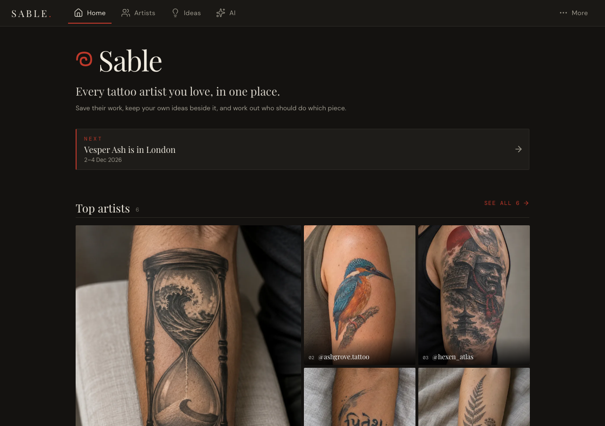
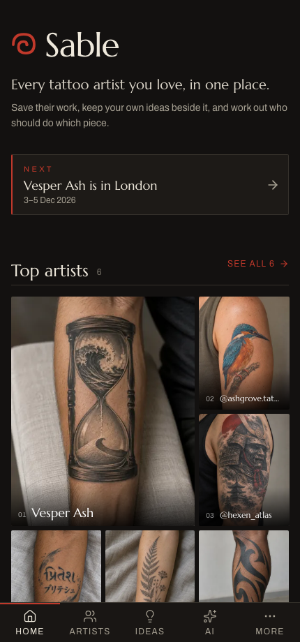
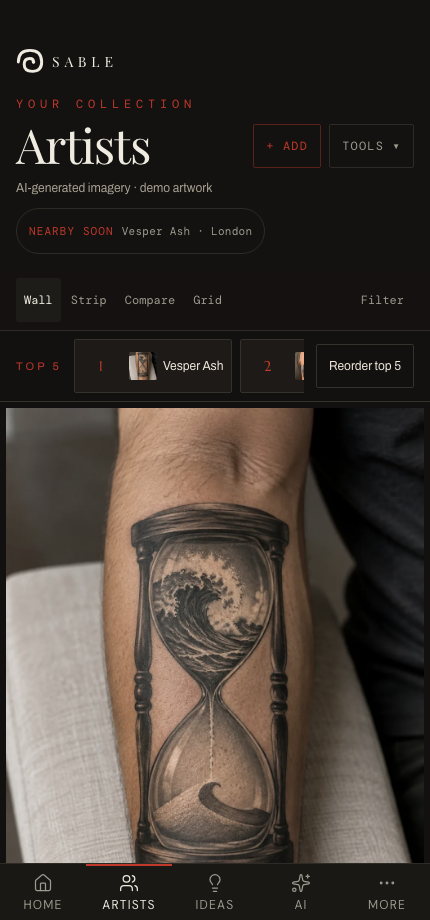
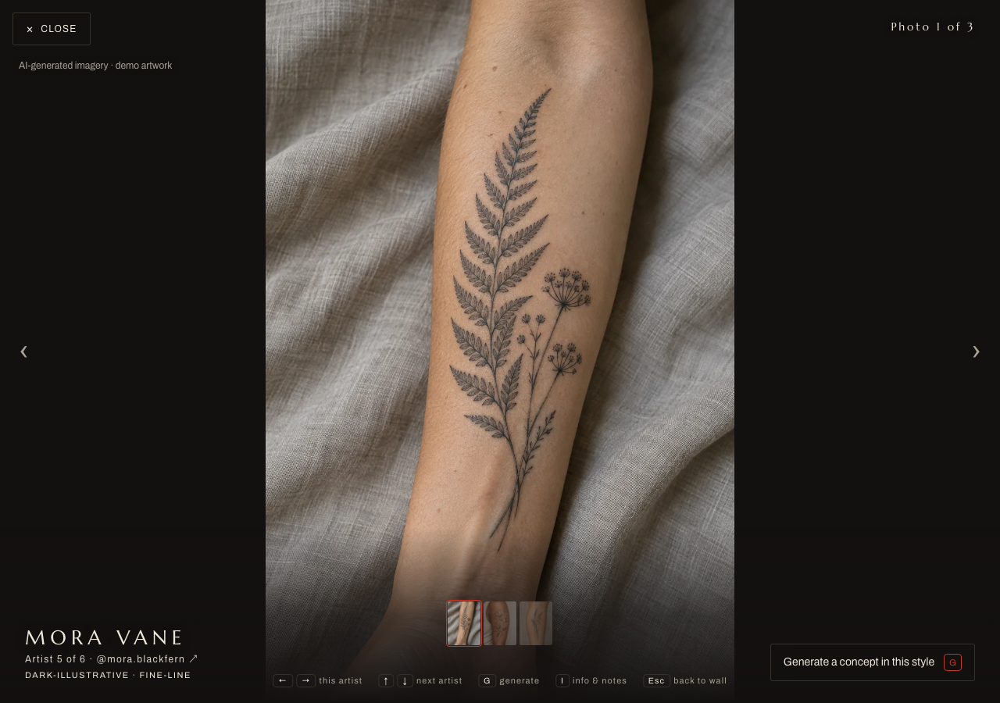
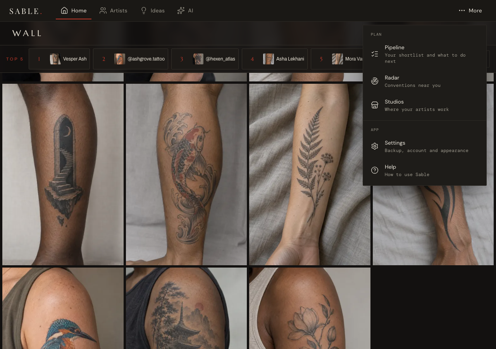
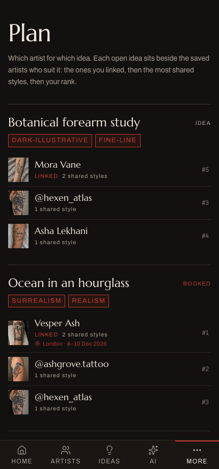
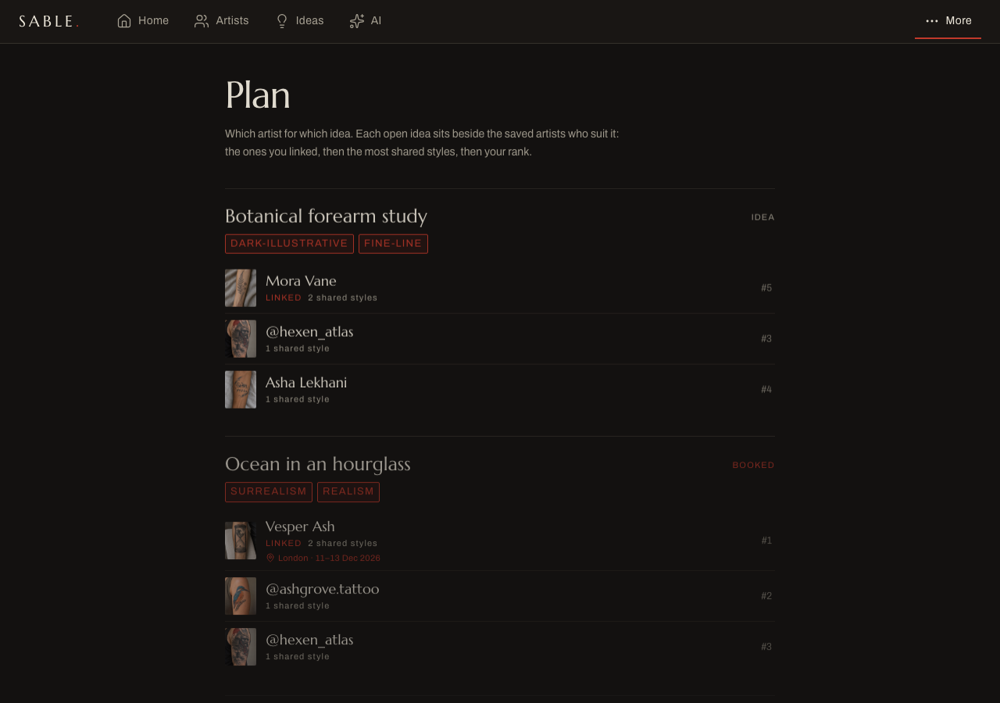

# Getting started

*Home, the Wall, the full-screen viewer, and how to move around.*

← [Back to contents](README.md)

---

## Signing in — or just looking

Sable opens on a sign-in screen. Enter your account details and you land on Home
with your own collection.

**Forgot your password?** On a real-account build, tap **Forgot password?** under the
form, enter your email and send the link. The message is the same whether or not the
address has an account. The link signs you in and asks for a new password (at least 8
characters, entered twice) before opening the app; **Cancel** signs you out instead.
The device-local demo has no passwords, so it has no such link.

Private builds use invite-only login and allow only the configured owner account.
Another account sees **Access denied** and can sign out; if no owner is configured,
the library stays closed. These builds do not offer the public demo.

Login and storage are separate. With device-local storage, your collection stays in
this browser even when you use a real account; signing in on another device does not
bring it across. Cross-device sync is available only in a cloud-storage build.

On the offline/public demo build, if you just want a look around, use
**No account? View the demo →** underneath the form. It loads a fully fictional
collection (six invented artists with AI-generated tattoo imagery) that runs entirely in your
browser; nothing syncs anywhere, and you can edit freely. To get back out, clear the
site's storage or open a fresh private window.

Demo updates replace the sample artists and ideas, including edits made to those
samples. They do not replace a real account's collection. Export anything you want
to keep before relying on the demo for your own planning.

The demo starts with Vesper, Ashgrove, Hexen, Asha, Mora, then Ferrum.
The favourites-first update resets older demo artists and ideas to those samples,
including removing extra demo artists. Real accounts are unchanged.

The artwork is synthetic, not a real tattoo artist's portfolio. An **AI-generated
imagery** label remains on the Wall, Artists, image viewer, ranking and image-bearing
editors even after you dismiss the introduction. Lettering examples are concepts,
not language-verified stencils.

The demo opens with a short strip across the top of Home that says
*You are looking at the demo.* Close it with **✕** and it stays closed on that device — it's an
introduction, not a banner. It never appears on a real account.

---

## Home

Sable opens on **Home**, a short start page:

- **Sable**, with one sentence on what it is.
- **Next**: one suggested step. In order: add your first artist, a nearby guest spot by
  an artist you saved, write your first idea, pick an artist for an idea that has none,
  make a first AI concept. Once all that is done, it points you to the Wall.
- **Top artists**: up to six, by rank, one photo each, the number one largest. Tap one to
  open that artist. **See all** goes to Artists.
- **Ideas**: up to three open ideas, and **New idea**.
- **AI concepts**: up to four, and **New concept**.

An empty section says what an artist, idea or concept is here and has a button to make
the first one.

### Starting from nothing

Every empty page says what it holds and gives one way to start:

- **Ideas** and **AI concepts** define an idea, a board and a concept, and show a faded
  **Example** of a filled one. The example is a picture only: it is not saved and goes
  away when you add your own.
- **Plan** shows three steps until you have an artist: add an artist, put them in
  order, write an idea. Only the current step has a button.
- **Add a sample artist** (empty Home, Artists and Plan) saves one invented artist,
  Vesper Ash, with three AI-generated photos, so you can try the wall, the viewer and
  ranking. It is a normal artist record and syncs like one. A note on Home and Artists
  marks it, and **Remove sample** takes it out in one tap.

## The Wall, in Artists

The **Wall** is the first view on the **Artists** page: every photo from every artist,
tiled edge to edge. The work itself is the interface.

- The artist's name sits on every tile. With a mouse, the studio shows on hover.
- A **red dot** means the photo is new: added within the last 14 days.
- Your **Top 5** is pinned above it. **Drag the rank number** on any tile to reorder the
  five, or tap **Reorder top 5** for the full ranking board (see
  [Gallery & ranking](03-gallery-and-ranking.md)).
- The style filter narrows the Wall too. Add an artist with **+ Add**.
- A **Consider** shelf suggests artists matched to the styles you already collect. Open
  the Instagram profile to judge for yourself, then **+ Add** (the form comes pre-filled)
  or **Not for me** (never suggested again). **Find more like this** asks AI for a fresh
  batch, marked *unverified* until you have looked. With a Gemini key saved, **↻ Refresh**
  in the shelf header re-runs discovery in one tap, skipping artists you already have or
  have dismissed.

## The full-screen viewer — one click in

**Click any photo** and it fills the screen. This is the heart of the app: flick through
an artist's work, soak in the style, and jump straight to generating a concept in it.

The keyboard does the driving:

| Key | Does |
|---|---|
| `←` `→` | previous / next photo by **this artist** |
| `↑` `↓` | jump to the **previous / next artist** |
| `G` | **generate a concept** in this artist's style |
| `I` | open the artist's **info & notes** (notes, linked ideas) |
| `Esc` | back to the Wall (with **info & notes** open, the first `Esc` closes just the panel) |

Outside the viewer, **Esc** closes whatever is on top (the add-artist sheet, the More
menu, a full-screen photo on an artist's page), one layer per press.
Wall photos, concepts, artist cards, thumbnails and ideas open with **Tab** then **Enter**.

The top right reads **Photo 1 of 3**; the plate shows **Artist 2 of 26 · @handle**. Moving
to a different artist ripples the photo in; moving between one artist's photos is a plain fade.

**On a phone** the photo opens with **× Close** and the photo count along the top, and a
slim bar at the bottom: the artist's name, **‹** and **›** buttons for the previous and next
photo, and a **More** handle between them. You can also swipe:

| Gesture | Does |
|---|---|
| swipe left / right | next / previous photo by **this artist** |
| swipe up | **next artist** |
| swipe down | close the viewer, back to the Wall |
| tap the photo (or **More**) | show or hide the panel: filmstrip, the artist's name and `@handle`, **‹ Previous artist** / **Next artist ›**, **Generate a concept** and **Info & notes** |

Pinch to zoom in on the linework as usual; swipes pause while you're zoomed in.

**Back closes the photo.** The browser's Back (Android's back button, Safari's back swipe)
takes you back to the Wall, not to the page you were on before it. The address shows the
photo you're on (`?photo=…`), so a link to it opens that photo. Swiping between photos
doesn't add to your history: one Back closes the viewer however many you looked at. An app
installed on the iPhone home screen has no back gesture; use **× Close** or swipe down.

A filmstrip of the artist's other photos sits along the bottom — click one to jump. The
artist's `@handle ↗` opens their Instagram in a new tab. With a mouse, leave it still for a
couple of seconds and the controls fade away, leaving just the image; move it or press a key
and they return.

You can also **paste a screenshot** (`⌘V`) while viewing an artist — it's added to that
artist's photos and gets a red *new* dot on the Wall.

## Moving around

Every page has the same navigation: a bar along the **bottom on a phone**, and the
same list along the **top on a laptop**.

- **Home** — the start page, above.
- **Artists** — Wall, filmstrip, compare and grid views, ranking, and Manage mode.
- **Ideas** — tattoo ideas, with Boards as a tab.
- **AI** — your generated concepts (see [AI concepts](06-concepts.md)).
- **More** — everything else, in two groups:

- **Find** — **Plan** (which artist for which idea, below), **Radar** (upcoming
  conventions) and **Studios** (where your artists work).
- **App** — **Settings** (backup, account and text size) and **Help** (short
  answers to common questions, each linking to its part of this guide).

## The Plan page

**More → Plan** answers one question: which artist for which idea. Each open idea
(not yet Done) sits beside up to three saved artists: any you already linked to it,
then the ones sharing the most of its styles, with your rank breaking ties. Each row
says how many styles it shares, and a pin marks an artist with a guest spot nearby
soon. An idea with no styles yet asks for some. Tap an idea to edit it, or an artist
to open their page.

Below the ideas, **Nearby soon** lists guest spots by your artists coming up near
Milton Keynes; its **Within** setting also decides which artists get the pin. A small
**Nearby soon** chip also sits in the Artists heading.

There is no artist status any more (researching → contact next → pass): Plan
replaced the old Pipeline page, which was built around that contact chain. Old
`/pipeline` links open Plan.

On a wide screen:

---

## What's already there

You don't start from a blank app:

- **Studios** and **Conventions** are pre-loaded. The public demo has fictional
  artists; offline owner builds can include a curated starter list. Real-auth
  libraries do not seed artists from an account's email address.
- **Ideas**, **Boards** and **AI concepts** start empty — those are yours to build.

> **Tip:** device-local data does not sync; cloud-storage builds sync to your account.
> **More → Settings → Export Backup** gives
> you a restore point you control (see [Settings, backup & restore](07-backup-and-settings.md)).

---

Next: **[Managing artists →](02-managing-artists.md)**
