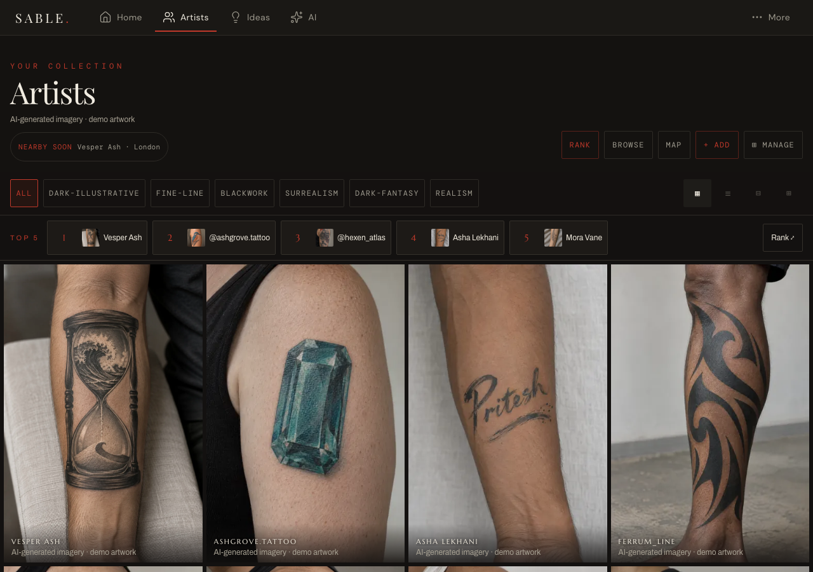
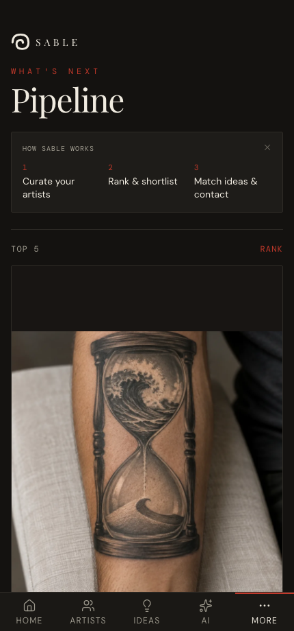
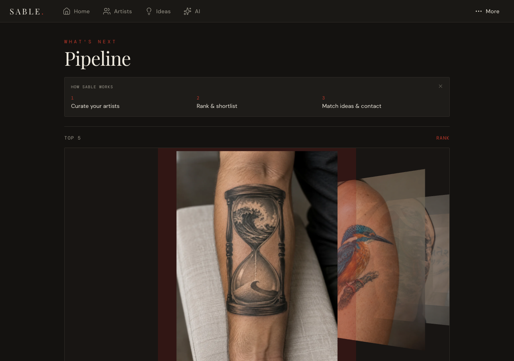

# Getting started

*The Wall, the full-screen viewer, and how to move around.*

← [Back to contents](README.md)

---

## Signing in — or just looking

Sable opens on a sign-in screen. Enter your account details and you land on the Wall
with your own collection.

Private builds use invite-only login and allow only the configured owner account.
Another account sees **Access denied** and can sign out; if no owner is configured,
the library stays closed. These builds do not offer the public demo.

Login and storage are separate. With device-local storage, your collection stays in
this browser even when you use a real account; signing in on another device does not
bring it across. Cross-device sync is available only in a cloud-storage build.

On the offline/public demo build, if you just want a look around, use
**No account? View the demo →** underneath the form. It loads a fully fictional
collection (six invented artists with AI-generated tattoo imagery) that runs entirely in your
browser; nothing syncs anywhere, and you can edit freely. To get back out, clear the
site's storage or open a fresh private window.

Demo updates replace the sample artists and ideas, including edits made to those
samples. They do not replace a real account's collection. Export anything you want
to keep before relying on the demo for your own planning.

The demo starts with Vesper, Ashgrove, Hexen, Asha, Mora, then Ferrum.
The favourites-first update resets older demo artists and ideas to those samples,
including removing extra demo artists. Real accounts are unchanged.

The artwork is synthetic, not a real tattoo artist's portfolio. An **AI-generated
imagery** label remains on the Wall, gallery, image viewer, ranking and image-bearing
editors even after you dismiss the introduction. Lettering examples are concepts,
not language-verified stencils.

The demo opens with a short strip across the top of the Wall explaining what you're
looking at. Close it with **✕** and it stays closed on that device — it's an
introduction, not a banner. It never appears on a real account.

---

## The Wall — your artists, edge to edge

Open Sable and you're on **the Wall**: every photo from every artist in your collection,
tiled edge to edge. No panels, no stats — the work itself is the interface.

- **Whose photo is it?** On a phone or tablet the artist's name (and their studio, when
  one is set) sits along the bottom edge of every tile. With a mouse it stays out of the
  way and fades in on hover.
- A **red dot** on a photo means it's new — added within the last 14 days.
- Pinned just under the bar is your **Top 5** — the five artists you've ranked highest,
  as a slim strip. **Drag the rank number** on any tile to reorder the five, or tap
  **Rank ⤢** to open the full ranking board (see
  [Gallery & ranking](03-gallery-and-ranking.md)).
- The Wall's own bar holds just its name and the **+** add-artist button. Getting
  around is the navigation's job (see [Moving around](#moving-around)).
- Just below the Top 5 strip, above the photos, a quiet **Consider** shelf suggests artists matched
  to the styles you already collect. Open the Instagram profile to judge for yourself,
  then **+ Add** (the form comes pre-filled) or **Not for me** (never suggested again).
  **Find more like this** asks AI for a fresh batch — those arrive marked *unverified*
  until you've looked at the profile. With a Gemini key saved, a **↻ Refresh** control
  in the shelf header re-runs AI discovery in one tap, skipping everyone you already
  have or have dismissed.

## The full-screen viewer — one click in

**Click any photo** and it fills the screen. This is the heart of the app: flick through
an artist's work, soak in the style, and jump straight to generating a concept in it.

The keyboard does the driving:

| Key | Does |
|---|---|
| `←` `→` | previous / next photo by **this artist** |
| `↑` `↓` | jump to the **previous / next artist** |
| `G` | **generate a concept** in this artist's style |
| `I` | open the artist's **info & notes** (status, notes, linked ideas) |
| `Esc` | back to the Wall (with **info & notes** open, the first `Esc` closes just the panel) |

Outside the viewer, **Esc** closes whatever is on top (the add-artist sheet, the More
menu, a full-screen photo on an artist's page, the status picker), one layer per press.
Wall photos, concepts, artist cards, thumbnails, Style Wall tiles and ideas open with **Tab** then **Enter**.

**On a phone** the photo opens clean, with just **× Close** and the photo count along the
top and a small **Details** handle at the bottom. Swipe instead of using the arrow keys:

| Gesture | Does |
|---|---|
| swipe left / right | next / previous photo by **this artist** |
| swipe up | **next artist** |
| swipe down | close the viewer, back to the Wall |
| tap the photo (or **Details**) | show or hide the panel: filmstrip, the artist's name and `@handle`, **‹ Previous artist** / **Next artist ›**, **Generate a concept** and **Info & notes** |

Pinch to zoom in on the linework as usual; swipes pause while you're zoomed in.

**Back closes the photo.** The browser's Back (Android's back button, Safari's back swipe)
takes you back to the Wall, not to the page you were on before it. The address shows the
photo you're on (`?photo=…`), so a link to it opens that photo. Swiping between photos
doesn't add to your history: one Back closes the viewer however many you looked at. An app
installed on the iPhone home screen has no back gesture; use **× Close** or swipe down.

A filmstrip of the artist's other photos sits along the bottom — click one to jump. The
artist's `@handle ↗` opens their Instagram in a new tab. With a mouse, leave it still for a
couple of seconds and the controls fade away, leaving just the image; move it or press a key
and they return.

You can also **paste a screenshot** (`⌘V`) while viewing an artist — it's added to that
artist's photos and gets a red *new* dot on the Wall.

## Moving around

Every page has the same navigation: a bar along the **bottom on a phone**, and the
same list along the **top on a laptop**.

- **Home** — the Wall and viewer, above.
- **Artists** — filmstrip, compare, grid and style-wall views, ranking, and Manage mode.
- **Ideas** — tattoo ideas, with Boards as a tab.
- **AI** — your generated concepts (see [AI concepts](06-concepts.md)).
- **More** — everything else, in two groups:

- **Plan** — **Pipeline** (the shortlist dashboard, below), **Radar** (upcoming
  conventions) and **Studios** (where your artists work).
- **App** — **Settings** (backup, account, theme and text size) and **Help** (this
  guide, in the app).

## The Pipeline page

The old Home dashboard lives on at **More → Pipeline**, titled *Pipeline* (Home is the
Wall): the Top 5 coverflow,
the shortlist pipeline (researching → shortlisted → contact next), idea stats, **Nearby soon**
(guest spots by your artists coming up near Milton Keynes) and idea matches.
The viewer's `I` panel shows each artist's status in place, so you'll mostly need Pipeline
when planning outreach.

On a wide screen it spreads into a multi-column layout:

---

## What's already there

You don't start from a blank app:

- **Studios** and **Conventions** are pre-loaded. The public demo has fictional
  artists; offline owner builds can include a curated starter list. Real-auth
  libraries do not seed artists from an account's email address.
- **Ideas**, **Boards** and **AI concepts** start empty — those are yours to build.

> **Tip:** device-local data does not sync; cloud-storage builds sync to your account.
> **More → Settings → Export Backup** gives
> you a restore point you control (see [Settings, backup & restore](07-backup-and-settings.md)).

---

Next: **[Managing artists →](02-managing-artists.md)**
