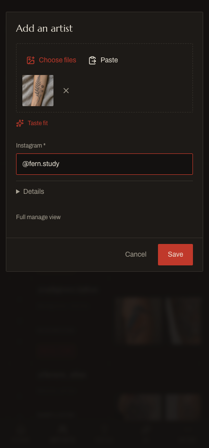
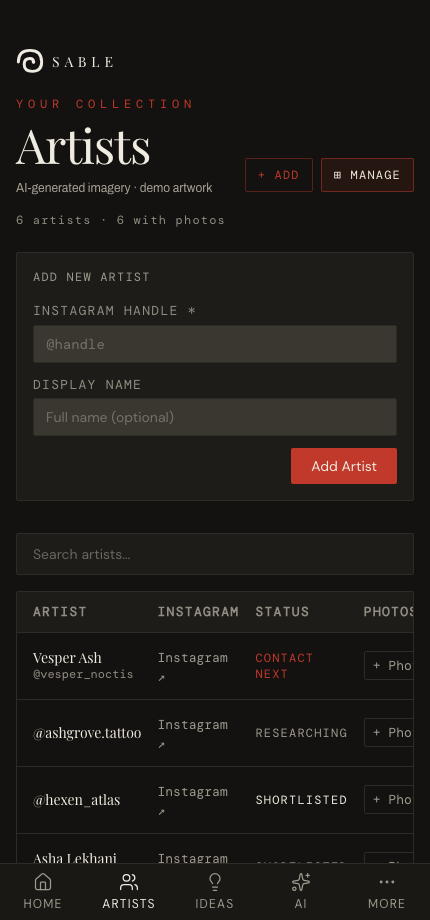
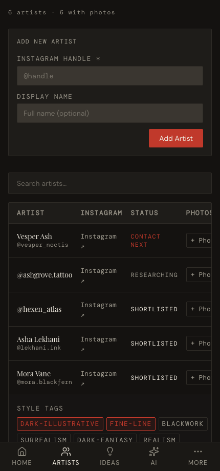

# Managing artists

*Add artists to your collection and give each one photos, style tags, a studio and notes.*

← [Back to contents](README.md)

---

## Add an artist — the quick way

Tap **+ Add** on the Artists page, or open `/gallery?add=1`. It opens the capture form.

1. **Choose files**, drop or paste screenshots if you have them. Several photos can
   be attached before you enter a handle. **Paste** reads the clipboard only when tapped.
2. Enter an **Instagram handle or profile link**, such as `@mora.blackfern` or
   `https://www.instagram.com/mora.blackfern/`. Post, reel and story links are
   rejected: they do not identify the artist.
3. Tap **Save**. No optional metadata is required.

**Details** starts collapsed and holds display name, tags and a style note.
You can add or edit those later. **Artist saved** confirms the local library update;
it does not claim cloud sync or an off-device backup. A new artist starts unranked, so
their photos join the end of the Wall, which scrolls down to them.

### Save a photo without an artist

Found a tattoo but not who made it? Attach the photo, then tap **Save without artist**
instead of **Save**. You do not need a handle. The photo goes to the front of the Wall,
marked **No artist yet**, and Sable says **Photo saved to the wall**.

Open it on the Wall to find the artist later. Any style note you typed shows under the
photo. **Give this an artist** lets you pick someone from your list; the photo moves to
their page, and the note becomes their style note if they have none. **Remove photo**
takes it off, with an Undo bar for a few seconds. Either way the viewer moves on to your
next saved photo, so you can sort a batch in one go; after the last one it shows the
first artist photo. A photo with no artist has no Artist count, handle or Generate
button. A style filter hides these photos.

### Favourite a photo

Open any photo on the Wall and tap the heart, or press **F** on a laptop. This works for
an artist's photo and for a photo with no artist. A favourited photo shows a small heart
on the Wall. Tap the heart again to remove it. The heart is off until the photo has
finished saving.

Tap **Filter**, then **Favourites**, to show only those photos. Open one and the arrows
move only through your favourites. With none yet, the Wall says how to add one.
Favourites sync with your account and are in your backup. A favourite stays when you give
a photo an artist. If you delete the photo, its favourite is hidden.

### More like this

Open any photo on the Wall and tap **More like this**, or press **M** on a laptop. On a phone it is in the bottom
panel; tap the photo to bring the panel up. The sheet lists the three artists whose work
sits closest to that one photo, then a grid of the photos most like it, including photos
with no artist. The photo's own artist is left out of the three. Tap an artist to open
their photos, or a photo to open it in the viewer. If a filter on the Wall hides it, the
filter is cleared first.

It uses the style index that Similar ink uses, which is built on this device. If it is
not built yet, the sheet says so and offers **Build style index** (a one-off model
download). If only this photo is missing, it offers **Update style index**. Photos are
compared on this device and never leave it.

### Search your photos

Tap **Tools → Search** in the Artists header and type what you are looking for:
*skull*, *wolf*, *a woman's face*. Matching photos come back grouped by artist, best
match first, including photos saved with no artist. Tap one to open it in the viewer;
Back brings you to the results again. If a filter on the Wall would hide the photo, the
filter is cleared first.

Search works best with **one subject**. A scene like *a snake wrapped round a dagger*
usually finds snakes or daggers, not both together. When nothing looks close enough, it
says so rather than show weak matches.

It searches the same on-device style index as More like this, so it covers only photos
that have been indexed (the sheet says how many, for example *Searching 412 of 430
photos*, and offers **Update style index** for the rest). The first search on each device
downloads a 67 MB model, once. The words and the photos stay on the device.

### Describe tattoo

Open any photo on the Wall and tap **Describe tattoo** (**Describe**, or press **D**, on a
laptop). On a phone it is in the bottom panel, next to More like this. A small sheet opens;
tap **Describe** and it shows a few sentences about the tattoo itself (subject, composition,
linework, shading and style), plus the style tags it fits. It never names or guesses the
artist or the person.

It uses Gemini with your own key from **Settings**; without one, the sheet says so and links
there. Tapping **Describe** is the only time the photo is sent to Google; opening the sheet
sends nothing. Moving to another photo closes the sheet. The description is kept on this
device, so opening it again is instant and free; **Describe again** asks afresh. Descriptions
are not synced, and are cleared when you sign out. Gemini can be wrong.

For an existing handle, attach photos and tap **Add images to … instead**. Sable
preserves the artist's existing details and confirms the number of photos added.
With no photos, **Already in your collection** appears and the append action is disabled.

Cancel, Escape, a backdrop tap and **Full manage view** ask before discarding an
edited capture. Declining keeps the fields and photos. During Save, dismissal and
repeat submission are disabled; an error leaves the capture open for retry. This
protection applies while the form is open, not to reload, sign-out or app termination.

### Auto-fill from a screenshot

Attaching a photo never starts an AI request. With a Gemini key saved
(Concepts → AI setup), tap **Auto-fill** to analyse the first staged screenshot.
This sends that image to Gemini and may incur provider charges. It suggests a
handle, name, tags and style note without overwriting your edits.

The same analysis locates the artwork and crops it on your device. **Use the whole
screenshot** restores the original if the crop clips something you wanted. Where an
on-device style index already exists, the form can also show a taste-fit score.
Without a key, photos remain uncropped and manual capture works normally; the
optional **Taste fit** action scores the whole screenshot and marks it rough.

### Share from Instagram

**Android / desktop Chrome.** An installed Sable app accepts shared image files.
**Share → Sable** opens capture with the photo attached, ready for a manual handle
or an explicit Auto-fill tap. This image-share route does not import shared text.

**iPhone.** Use a one-off Shortcut and then paste into Sable. Settings shows
**Install Share to Sable** only when an actual iCloud Shortcut link is configured.
No signed Shortcut is bundled with this repository; without a link, use the setup
guide and build it manually:

1. New Shortcut → **Show in Share Sheet** → accept **Images, URLs and Text**.
2. **Copy to Clipboard**, using Shortcut Input. If Instagram shares multiple items,
   select the intended screenshot or profile link first rather than combining them.
3. **Open URL** → your deployment's fixed share address. For the public demo this is
   `https://pritesh1980.github.io/sable/share`; a root deployment uses `/share`.
   Do not put screenshot bytes or the shared text into the URL.
4. Name it **Sable**.

After **Share → Sable**, tap **Paste** in capture. If clipboard image reading is
unavailable or denied, **Choose files** still works; for a profile link, long-press
the Instagram field and paste there. A screenshot needs the artist's handle unless
you explicitly use Auto-fill.

**Real-iPhone acceptance is pending.** The recipe can open Safari rather than the
installed home-screen app, which may mean a different session or local library.
Use the intended Sable context; do not assume your library has transferred between
them. Desktop browser tests do not verify that phone handoff.

## Add photos as you find them

You don't need a form to grow a portfolio:

- **Drag an image file onto an artist's photo on the Wall** — the tile highlights, and the
  drop adds the image to that artist.
- **Paste (`⌘V`) while viewing an artist full-screen** — the screenshot is added to
  whichever artist is on screen.

Either way the new photo is stamped as recent and wears a red dot for two weeks.
Images stay in the selected storage: device-local builds keep them in this browser;
only cloud-storage builds sync them to your other devices. Real login alone does not
enable cloud sync.

## The manage table

Deeper upkeep lives on the classic Artists page — **Artists**, then the
**Tools → Manage** in the header (or deep-link to `/gallery?mode=manage`). A count of
artists and photos sits at the top.

The **Add New Artist** panel inside Manage mode still works too (and also accepts URLs).

Below the add-artist panel is a searchable table of every artist with their Instagram
link and photo count. Type in the **search** box to filter by name or handle.

## Edit an artist

**Tap a row to expand it.** You get everything for that artist in one place:

- **Style tags** — tap to toggle (`dark-illustrative`, `fine-line`, `blackwork`,
  `surrealism`, `dark-fantasy`, `realism`). These power the matching in *Ideas* and *AI*.
- **Studio** — pick where they work; this populates the [Studios](05-conventions-and-studios.md) page.
- **Notes** — free text; saves when you tap away or press Enter.
- **Photos** — tap **+ Photos** to upload screenshots (they're compressed automatically).
  Tap a thumbnail's **×** to remove it — the × is always visible on touch, and appears
  on hover with a mouse. There's no confirmation prompt; instead a **Photo removed
  from <artist> — Undo** bar appears for a few seconds, and Undo puts the photo back
  where it was. The bar sticks around even if you collapse the row, so you can still
  take it back — and only ever one shows at a time, so removing a second photo
  commits the first.
- **Remove artist** — deletes them from your collection (with a confirmation).

### Tidy-up hints

Once the on-device style index is built (see [More like this](#more-like-this)), Manage
can point out two things. Neither needs an AI key or a download beyond the index, and
neither changes anything until you tap.

- **Suggested tags.** Under the style tags, a dashed **+ realism** chip with a reason:
  *looks like A, B and C, tagged realism*. It appears when at least 3 of the 5 artists
  whose work looks most like this one carry the tag. Tap the chip to add the tag, or
  ignore it. Only `fine-line` and `realism` are suggested: tested against the tags
  you'd already chosen, they were the two this got right about three times in four.
  The other four styles weren't reliable enough to suggest.
- **Doesn't look like the rest.** A photo that sits far from the artist's other photos,
  often a selfie, a booking poster, a studio shot or someone else's work, is listed
  under the photos with **Keep** and **Remove**. A row with one shows **1 photo to check**
  under the artist's name. **Remove** works like the thumbnail ×, with Undo. **Keep**
  is remembered on the artist, synced with the rest of your library, so that photo
  won't be asked about again. Artists need at least 4 indexed photos for this.

Photos added since the index was last built aren't checked until you update it.

A photo added twice under different names is a different job: see
[Find duplicate photos](07-backup-and-settings.md#find-duplicate-photos) in Settings.

> **Tip:** you can also upload photos and edit tags/studio from an artist's full
> detail card in the [gallery views](03-gallery-and-ranking.md) — whichever is handier.
> Tap **Done managing** to flip back to the visual views. Backups now live in
> [More → Settings](07-backup-and-settings.md).

---

Next: **[Gallery & ranking →](03-gallery-and-ranking.md)**
