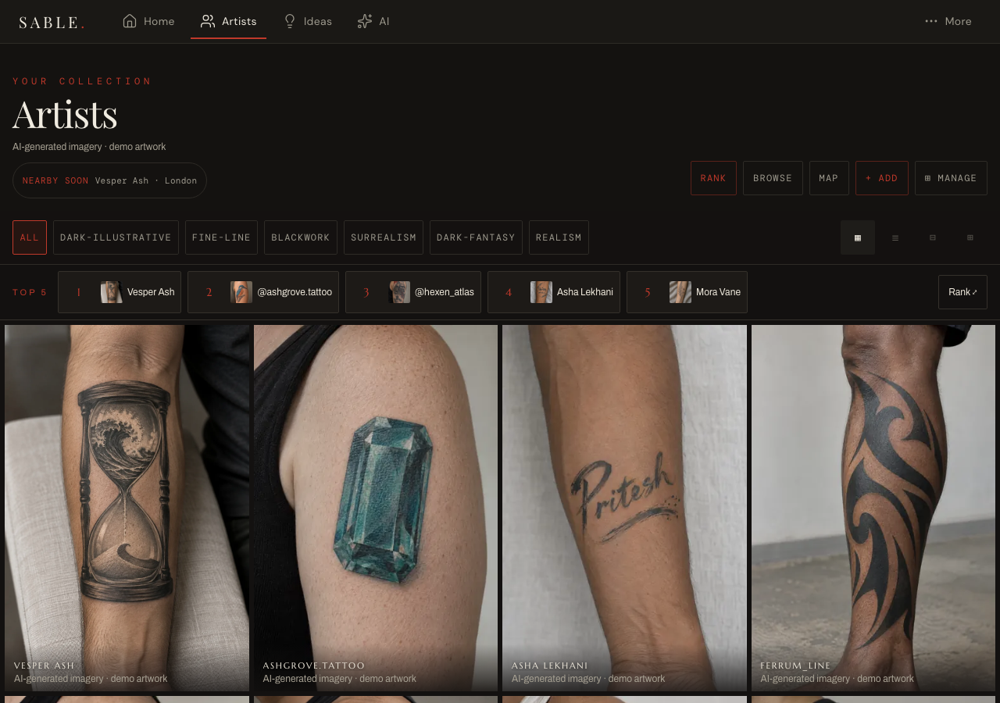
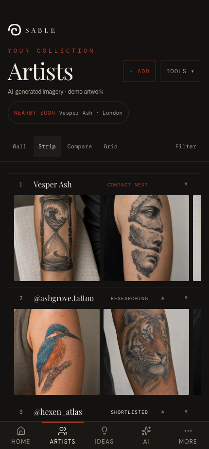
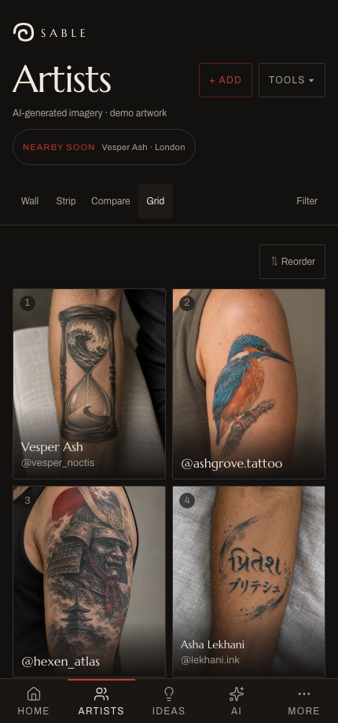
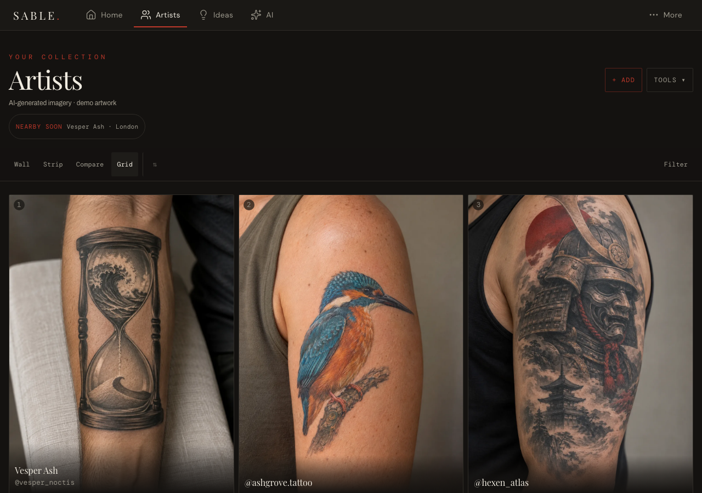
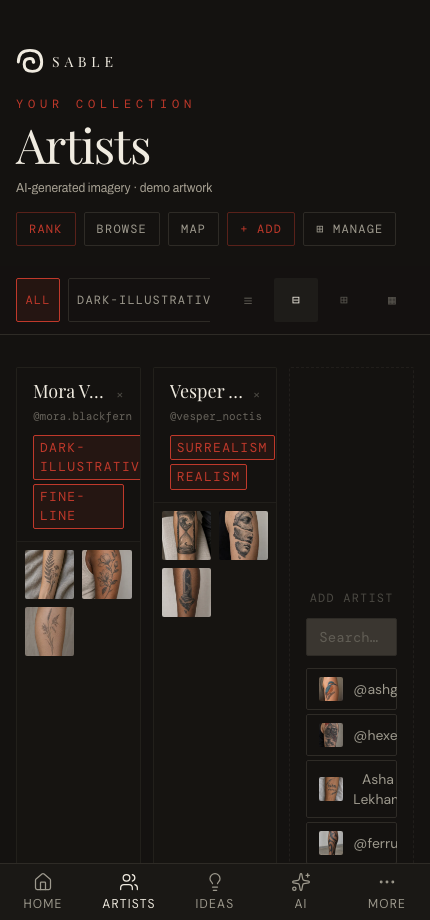
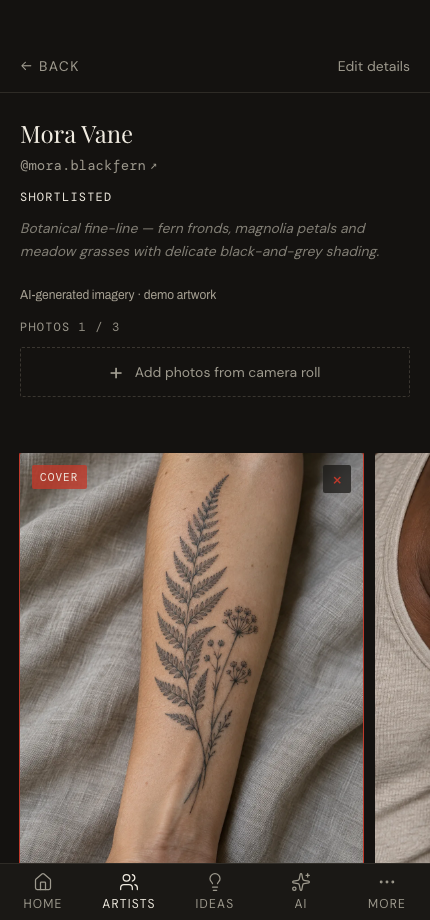
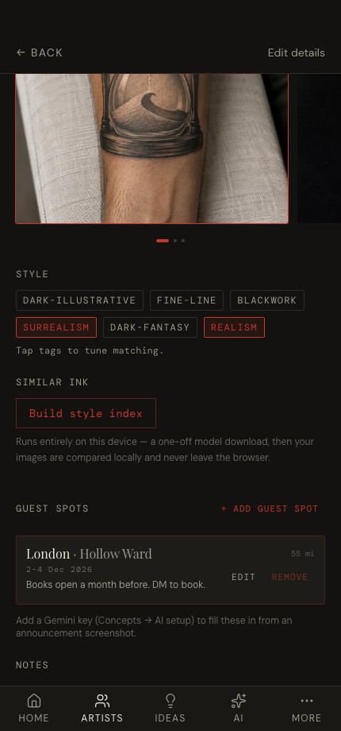
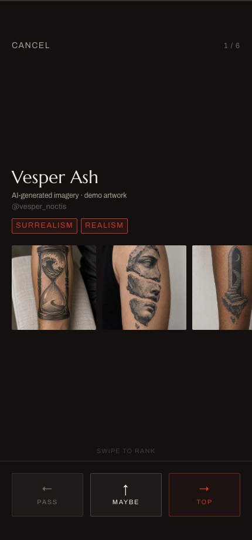

# Gallery & ranking

*Browse your collection four ways, filter by style, open any artist, and put them in priority order.*

← [Back to contents](README.md)

The public demo uses synthetic portfolio photographs across botanical, surrealist,
Japanese-inspired, tribal, colour-realism and brush-lettering styles. Its
**AI-generated imagery** disclosure is separate from editable artist notes.

---

The **Artists** page is where browsing and organising live. A sticky bar at the top holds the
**view switch** (**Wall**, **Strip**, **Compare**, **Grid**) and a **Filter** button. Tap
**Filter** to open the style tags and pick one: it narrows every view, the Wall included,
and shows as a chip in the bar. Tap the chip to clear it. The header's **Tools** menu holds
**Rank**, **Browse**, **Map** and **Manage**, each with a line saying what it does. The
**Wall** is the default. Everyday ranking happens on it: see
[Ranking your favourites](#ranking-your-favourites) below. With no artists saved yet, every
view shows **+ Add artist**, which opens the same capture form as **+ Add** in the header.

A small **Nearby soon** chip in the heading shows the soonest guest spot by a saved artist,
with **+N** linking to Pipeline.

## The four views

### Wall
Every photo from every artist, edge to edge, with your Top 5 pinned above. It is the
default view; see [Getting started](01-getting-started.md#the-wall-in-artists).

### Strip (filmstrip)
One artist per row: a thin line with their rank, name, status and **▲ / ▼**, then a strip
of large photos to swipe sideways. Tap the name or a photo to open the artist, where the
handle and style tags live.

### Grid
A continuous two-column grid on phones, with names and handles wrapping inside
each card. Wider screens retain a featured top-three row. Tapping anywhere on a card opens that
artist — the whole tile is the target, with nothing else competing for it.

To reorder or add photos, turn on **⇅ Reorder** (next to the view toggle). Each card
grows a drag handle in its top corner and a **+** for adding photos; **drag a card** to
reorder and its new position becomes its rank. Turn Reorder off to go back to browsing.
Switching to another view turns it off for you.

> **Keyboard:** with Reorder on, Tab to a card's handle, press **Space** to pick it up,
> move it with the **arrow keys**, then **Space** to drop it (or **Esc** to cancel).

On a wider screen the grid expands to show more artists per row:

### Compare
Put artists side by side, each as a name and one column of large photos: two on a phone,
up to four on a wider screen.

---

## Opening an artist

Tap any card to open the full **artist detail**: a photo carousel, their tags, status,
studio, notes, and any conventions they're attending. Tap **Edit details** to change them.
**← Back**, or the browser's Back (Android's back button, Safari's back swipe), closes it
and leaves you on the gallery. The address shows the artist (`?artist=…`), so a link to it
opens their detail.

### Guest spots

Many artists travel, and announce it on Instagram ("London 12–14 Feb, DM to book"). Under
**Guest spots** on the artist detail, tap **+ Add guest spot** and enter the city, the
studio, the dates (picking **From** fills an empty **To**), a link to the announcement and
any notes, such as when books open. It saves straight away. Each spot shows its distance
from Milton Keynes. London areas such as Hackney or Shoreditch count as London, and "Area,
City" works too. A place Sable doesn't know shows *distance unknown* (it never guesses), and
won't appear in Nearby soon, so the form says so while you type. Upcoming spots are listed first; earlier ones fold away under
**Past**. **Edit** and **Remove** sit on each one.

With a Gemini key set (Concepts → AI setup), **From a screenshot** reads an announcement
for you. Choose the screenshot, then tap **Read dates**: that tap is the only point the image
is sent. Each city it finds appears as a suggestion, with any booking note it could read
("Books open 1 Mar, DM to book"), and the screenshot stays on screen to check against.
**Review** fills the form so you can check it before **Save**, and **Dismiss** drops one.
Nothing is saved until you do.

Spots by your saved artists in the next 90 days and within reach show up as **Nearby
soon** on the Pipeline page (100 miles by default; the **Within** menu changes it, and this
device remembers your choice), with their notes, and as a chip in the Artists heading (the
soonest one, then **+N** to Pipeline). Home's **Next** line can suggest it too. Tapping one opens
the artist at their Guest spots. Artists you've marked *pass* are left out.

### Similar ink

Below the style tags, the detail view can show the three artists in your collection
whose work looks most alike — matched on the images themselves, not just tags. The
first time, tap **Build style index**: a small vision model is downloaded once and
every comparison then runs entirely on your device (your images never leave the
browser). Indexing the whole collection takes a minute or two; after that it only
processes newly added photos, and each device keeps its own index. Tap a match to
jump to that artist.

Beneath the matches, a **taste line** shows what the model has learned from your own
behaviour: how strongly this artist's work fits the taste implied by your ranking and
shortlist statuses, and where the model would place them on images alone — a useful
nudge when it disagrees with where you've actually ranked them.

### Taste map

Tap **Tools → Map** in the Artists header to see your whole collection laid out by what the
work looks like: artists whose ink looks alike sit closer together, each ringed in the
colour of their main style (the key is underneath). **✦ You** marks your taste — the
blend of everyone's work weighted by your ranking and shortlist statuses — so you can
see which corner of your collection pulls you most, and spot artists sitting far from
everything else. Tap anyone to open them. It uses the same on-device style index as
Similar ink; if you haven't built it yet, the map offers **Build style index**.

---

## Ranking your favourites

Everything below sets the **same single ranking** — one ordered list of every artist.

The quickest place to rank is the **Wall**, the default Artists view. Your **Top 5** is pinned at the top:
**drag the rank number** on any tile to reorder the five, or tap **Reorder top 5** to open the
full **ranking board** — your Top 5 pinned up top, everyone else below, with **▲ / ▼** on
every row, **Drop ↓** to push an artist out of the Top 5, and **↑ To top 5** to pull one
in. Close it (or press **Esc**) to return to the Wall.

The Artists page keeps its own ranking tools for when you're already there organising:

1. **Drag** in Grid view, with **⇅ Reorder** turned on.
2. **Nudge** the rank number up/down in Filmstrip view.
3. **Swipe-compare** — tap **Tools → Rank** (top-right of the Artists page) to judge artists one at
   a time as **Pass / Maybe / Top**, with a scrollable row of all their reference images
   to browse before you decide. Made a mistake? **Undo** reverses your last decision.

> **Tip:** ranking flows through the whole app — the **Top 5** on Home and the Wall and **Contact next**,
> and the artist suggestions in *Brief*, all respect the order you set here.

---

Next: **[Brief & boards →](04-brief-and-boards.md)**
