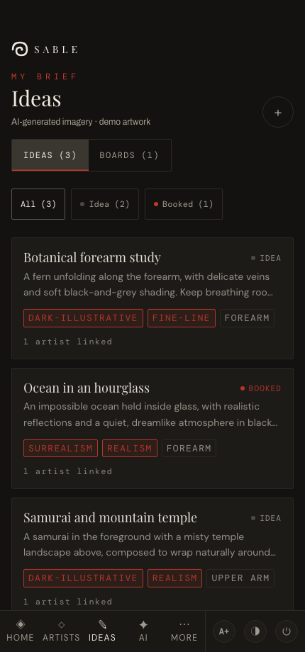
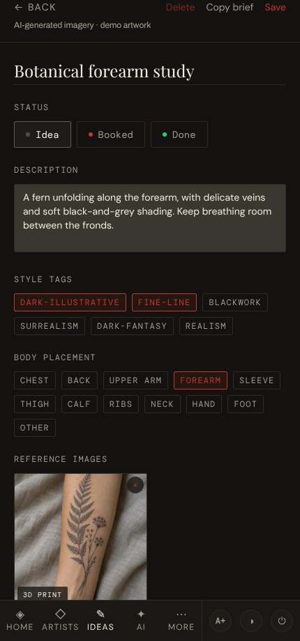
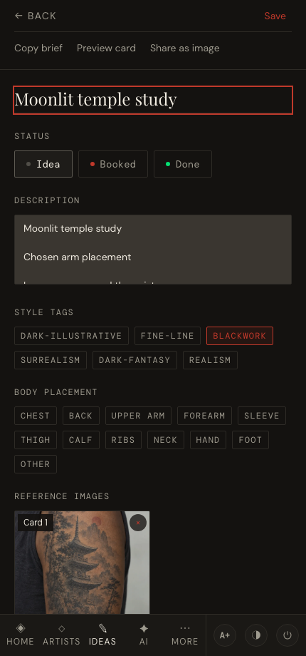
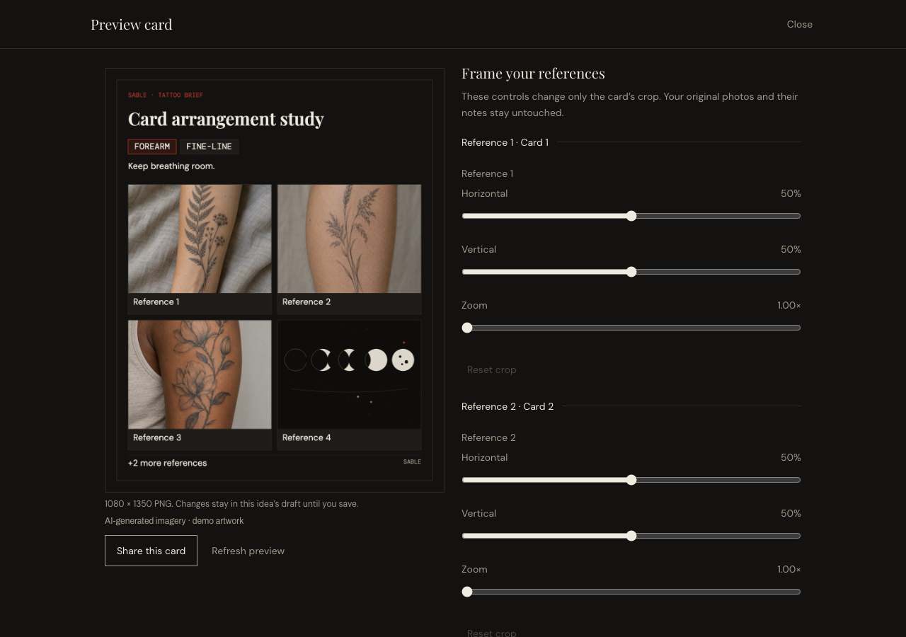
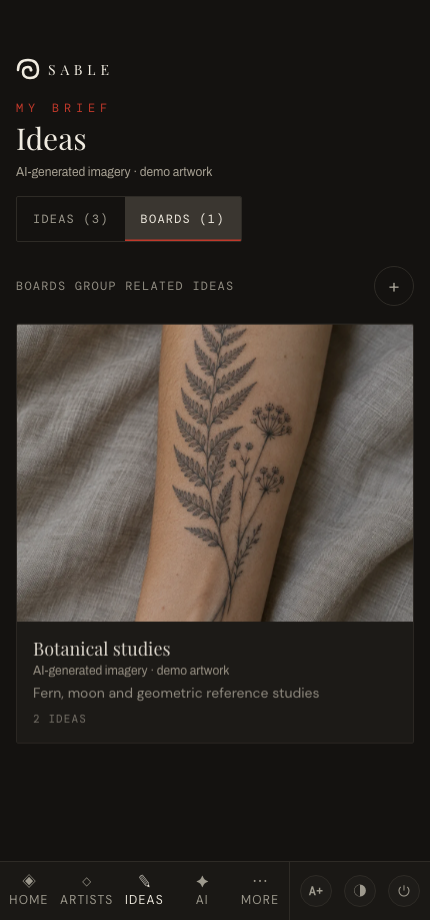
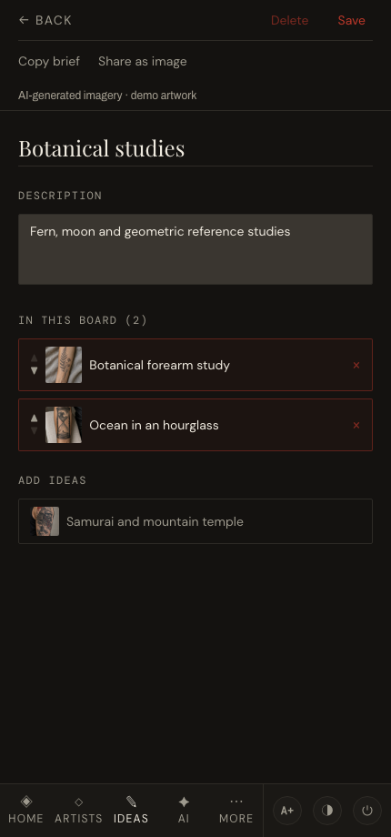

# Ideas & boards

*Capture tattoo ideas, link the artists who suit them, and group related ideas into mood boards you can share.*

← [Back to contents](README.md)

---

## Your Brief

**Brief** is your collection of tattoo ideas. Each card shows the title, a snippet, style
tags, placement and how many artists are linked. The tabs at the top filter by status
(**All / Idea / Booked / Done**). A status tab only appears once at least one idea has
that status, so there is no **Done** tab until something is done.

### Create or edit an idea

Tap **+** to add an idea (or tap a card to edit one). The editor gives you:

- **Title** and **description**.
- **Status** — Idea, Booked or Done.
- **Style tags** — the same six styles used across the app.
- **Body placement** — chest, forearm, sleeve, etc.
- **Fill idea from image** — with a Gemini key set and at least one uploaded reference
  image, this button drafts the title, description, style tags and placement from the
  image itself; only fields you haven't filled are touched.
- **Reference images** — paste an image URL or upload photos, each with a note on *what to
  borrow from it*. **3D print** on an image opens the relief STL export for it (see
  [AI concepts](06-concepts.md#export-a-relief-stl)). **On arm** puts it on the 3D arm at
  its real size, on the forearm when the idea's placement is *forearm* and on the upper arm
  otherwise; **Add to references** keeps the picture as another reference, noted with its
  width (see [On the arm in 3D](06-concepts.md#see-a-concept-on-the-arm-in-3d)). Save the
  idea to keep it. It works best with a flat design (a drawing, a flash sheet, a concept):
  a photo of a tattoo already on skin goes on whole, its skin and background included.

If an idea uses a shipped demo image, its editor keeps the **AI-generated imagery** label
visible while you review or change its references.

### Artists match automatically

As soon as an idea has style tags, the editor shows **matching artists**, ranked by how
many tags overlap, their shortlist status and their rank. **Tap an artist to link them**
to the idea. (Before any tags are set, you'll see lighter *suggestions* instead.)

Use the sharing row below **Back** and **Save**. **Share as image** exports a 1080×1350
brief card ready for an Instagram DM, with the title, placement, style tags, description
and linked artists. The card shows up to four available reference photos, with short
captions from their notes and a count of any extra references.
External web image links are skipped; the editor tells you how many.

The editor opens the system share sheet when available. Otherwise it requests a PNG download
and briefly says **Download requested**; check your downloads for the file. Use **Copy brief**
instead to put a formatted plain-text summary on your clipboard.

### Bring an AI concept into an idea

In **Concepts**, choose **Use in idea** on an original image or an expanded AI result.
**New idea** opens a draft with the prompt, notes, styles and chosen image; review it
and tap **Save** to keep it. **Add to existing idea** lets you search by title, add an
optional reference note and confirm **Add image to idea**. That adds the reference
immediately and opens the idea without changing its other fields or crops.

The idea keeps its own image copy, so deleting the source concept does not remove
the reference. It can copy an image already stored on this device while offline;
otherwise reconnect and retry. No AI request is made.

### Choose the card's photos

Use **Make cover** or the left/right arrows beneath a reference to reorder it.
The first reference becomes the idea's cover; **Card 1–4** marks the photos actually
prepared for export. **Checking card…** means selection is still being checked.
External links and unavailable photos stay in the idea but are labelled as excluded.

### Preview and crop before sharing

Tap **Preview card** to see the exact PNG you will share. **Horizontal**, **Vertical**
and **Zoom** adjust the export crop of each selected reference; **Reset crop** restores
its centred crop. Captions, original photos and their other uses are unchanged.
On a phone, the card stays visible while the crop controls scroll below it.

After an edit, the old preview is hidden and sharing waits for the updated card.
**Share this card** shares those exact prepared bytes. Quick **Share as image** in the
editor uses the same prepared card without requiring a preview. **Refresh preview**
retries photos that could not be read; a failed preparation also offers **Refresh card**
in the editor.

Close the preview to return to the editor, then **Save** the idea to keep its reference
order and crop settings. Back without saving discards those draft changes.
Crop settings follow each reference through backup and restore.

---

## Mood boards

**Boards** (the second tab on the Ideas page) group related ideas into a themed collection — handy for a
sleeve or a connected set of pieces. A board can keep its own cover; otherwise its cover
comes from the first idea with an image. A generated demo cover is labeled on the board
card, and the label stays visible in the board editor when demo references appear.

### Build a board

Tap **+** (you need at least one idea first). In the board editor you can:

- Give the board a **name** and **description**.
- **Add ideas** from the list at the bottom; **reorder** them with the ▲ ▼ arrows; remove
  one with **×**.
- **Copy brief** to export the whole board — every idea plus its linked artists — as text.
- **Share as image** to export a 1080×1350 board summary card (board title, description,
  combined placements/styles/artists, and up to four member ideas' hero reference photos
  with their titles) via the system share sheet or as a PNG download.

> **Tip:** deleting a board never deletes the ideas inside it.

---

Next: **[Conventions & studios →](05-conventions-and-studios.md)**
