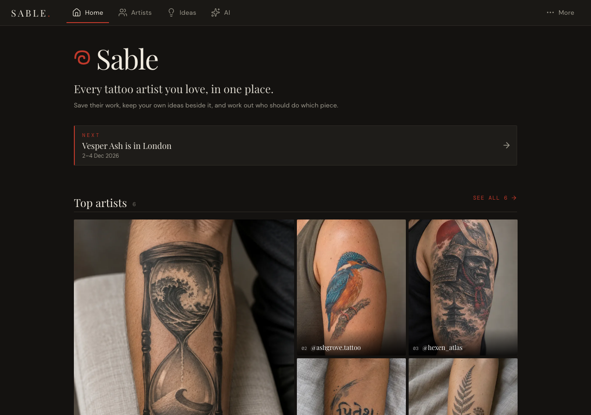
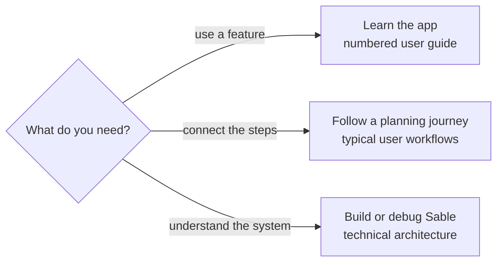
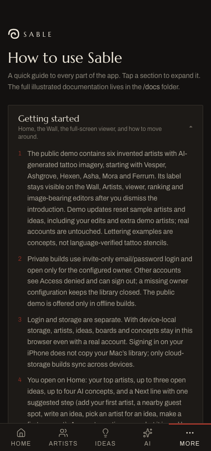

# Sable — User Guide

**Sable** puts every tattoo artist you love in one place — a gallery built for
browsing rather than a folder of screenshots. Each artist keeps their own work,
handle, styles and your notes together, and Sable learns your taste by *looking* at
that work: add an artist and it predicts roughly where they'd rank, open one and it
shows who else in your collection sits closest. From there it goes as deep as you
want — ranking, tattoo ideas linked to artists, concepts, conventions and studios.

It runs in your browser and installs to your phone's home screen like a native app.
Real login and storage are separate: device-local builds keep the library on that
device; only cloud-storage builds sync across devices. Export a portable backup
before moving devices. The taste model runs on-device. Explicit AI actions can
send their selected image or instructions with consent; they are not background sync.

Image refinement is covered in [AI concepts](06-concepts.md#refine-an-image).
Private paid activation remains an [unactivated approval checklist](RELAY-ACTIVATION.md).

---

## Start here

Use the numbered sections below to learn individual features, the
[typical user workflows](USER-WORKFLOWS.md) to follow end-to-end journeys, or the
[technical architecture](ARCHITECTURE.md) to build and debug the system.

---

## How the app is organised

Sable opens on **Home**: your top artists, ideas and concepts, and one suggested next step.
The **Wall**, in Artists, shows every photo from every artist you follow, edge to edge.
Click any photo and it fills the screen; from there the keyboard drives everything,
including generating a concept in that artist's style (`G`). One navigation is on every
page: a bottom bar on a phone, a top bar on a laptop.

| The bar | | Under More |
|---|---|---|
| **Home** — start page and next step | | **Find**: **Plan** — which artist for which idea |
| **Artists** — Wall, filmstrip, compare, grid, ranking & Manage | | **Plan**: **Radar** · **Studios** |
| **Ideas** — tattoo ideas, with Boards as a tab | | **App**: **Settings** · **Help** |
| **AI** — generated concepts on their own wall | | |

A short version is built into the app under **More → Help**: plain questions (*How do I add
an artist?*), each answered in a few lines with a link to its part of this guide.

> **Fresh libraries depend on the build.** The public demo loads six fictional artists
> and three sample ideas. Real-auth private libraries start empty; legacy local owner
> builds can seed the curated artist list.
> Studios and conventions are shipped reference data; boards and concepts start empty.

---

## The workflows

This index, the numbered guides, architecture/workflow maps and in-app Help describe
the current code. Dated files under `plans/` and `superpowers/` are historical design
records, not activation instructions. The shared guide screenshots use fictional data.

1. **[Getting started](01-getting-started.md)** — Home, the Wall, the full-screen viewer, moving around.
2. **[Managing artists](02-managing-artists.md)** — add artists, photos, tags, notes.
3. **[Gallery & ranking](03-gallery-and-ranking.md)** — the classic browse views, filtering, and ranking.
4. **[Ideas & boards](04-brief-and-boards.md)** — capture ideas, link artists, build boards.
5. **[Conventions & studios](05-conventions-and-studios.md)** — shows near you, their artist line-ups and competition winners, and where artists work.
6. **[AI concepts](06-concepts.md)** — generate in an artist's style, prompt packs, variants, relief STLs.
7. **[Settings, backup & restore](07-backup-and-settings.md)** — account, backups, and moving data.

---

## Architecture and workflow maps

- **[Technical architecture](ARCHITECTURE.md)** — runtime boundaries, routes, local-first
  sync, image persistence, on-device AI, PWA delivery, and deliberate trade-offs.
- **[Typical user workflows](USER-WORKFLOWS.md)** — visual maps from artist discovery
  through briefs, concepts, contact planning, offline work, and recovery.

---

## Desktop tools (on the Mac)

- **[On-body renders with Blender](BLENDER.md)** — wrap a concept round a 3D forearm (a
  smooth tube, or MakeHuman's real arm with its hand) at a true size in cm, render three
  angles, and import them back as results.

---

## A typical planning journey

The pieces are designed to feed each other:

1. **Find** an artist on Instagram and tap **+ Add** on the Artists page — paste the handle
   or URL, tick their styles, drop in a few screenshots. Done in one form.
2. **Look.** Click a photo, arrow through their work, `↑`/`↓` to drift between artists.
   New photos you add wear a red dot for two weeks.
3. Found the style? Press **`G`** — the Concepts composer opens already steered to that
   artist. Describe the idea, pick a placement, generate (or copy the prompt into your AI
   of choice and paste the result back).
4. **Capture an idea** in *Ideas*, tag it with styles, and it suggests matching artists
   to link. **Group related ideas** on the Boards tab; **Copy brief** shares a clean summary.
5. **Rank** in *Artists*; *More → Plan* puts each open idea beside the artists who
   suit it.
6. Check **More → Radar** for conventions where your shortlisted artists are appearing, and
   **Studios** for where they work and how far that is.
7. **Export a backup** from *More → Settings* so you always hold a restore point.

---

## Installing on your iPhone

Sable is a Progressive Web App, so it installs without an app store:

1. Open the app's URL in **Safari**.
2. Tap the **Share** button, then **Add to Home Screen**.
3. Launch it from the new icon — it opens full-screen, in dark mode, like a native app.
